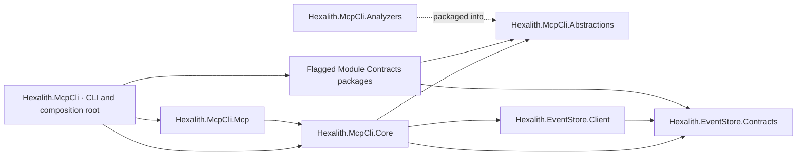
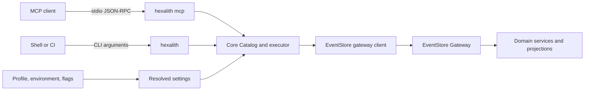
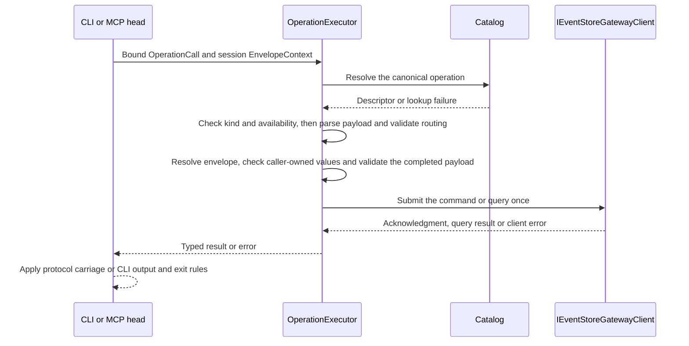

# Architecture Spine — Hexalith.McpCli

## Design Paradigm

**Hexagonal.** One core that knows Contracts types, the Catalog, validation, the Envelope, and the gateway port. Two adapters (the MCP Server head and the CLI head) that translate their protocol into the core's call model and back, and nothing else. The gateway client, the settings sources, and id generation are ports.

**What ships.** The first public pair was 2.0.1. The 3.0.0 tool released on 15 November contains Parties and Tenants. At McpCli revision `e79b7f8b`, the same shared executor serves 26 Operations across Parties (7), Tenants (15) and Projects (4). Projects still needs populated, authorized reads and denial evidence. Folders has published its Contracts and Aspire helper. Two restricted command declarations and outstanding Gateway work still block its enrollment (AD-15/23). The next stable tool release requires a publishing decision and archive verification under AD-17. [Public release](https://github.com/Hexalith/Hexalith.McpCli/releases/tag/v3.0.0) · [Source cohort and qualification](../../prds/prd-mcpcli-2026-09-21/prd.md#module-enrollment-on-2026-11-20)

**Ecosystem boundary.** Both Heads expose eligible Gateway Commands and Queries through one Catalog. AD-23 gives each legacy capability an owner and disposition, including confidential UI, named local-tooling exemptions and withdrawal. Hosted HTTP and stream transport require their own admission decisions. Each proprietary surface keeps its authorization, semantic and retirement gates. [Adopted capability classes](AD-23-non-gateway-capability-classes.md)

| Hexagon layer | Project | Namespace root |
| --- | --- | --- |
| Contract the Modules see | `Hexalith.McpCli.Abstractions` (the Decoration Package) | `Hexalith.McpCli.Abstractions` |
| Core (domain of this tool) | `Hexalith.McpCli.Core` | `Hexalith.McpCli.Core.Catalog`, `.Schema`, `.Execution`, `.Settings`, `.Serialization` |
| Adapter, MCP | `Hexalith.McpCli.Mcp` | `Hexalith.McpCli.Mcp` |
| Adapter, CLI + composition root | `Hexalith.McpCli` (the tool executable) | `Hexalith.McpCli.Cli`, `Hexalith.McpCli.Hosting` |
| Build-time discovery | MSBuild target in `Hexalith.McpCli` | generated `ModuleAssemblyManifest` |
| Author-time guard | `Hexalith.McpCli.Analyzers` | `Hexalith.McpCli.Analyzers` |

## Invariants & Rules

### AD-1 — Heads are translators; the core decides

- **Binds:** all
- **Prevents:** a head validating a Payload, filling an Envelope, enforcing Read-only Mode, resolving settings, or reflecting over a Contracts type on its own, so that the two Heads disagree (SM-4).
- **Rule:** `Hexalith.McpCli.Core` references no MCP, System.CommandLine, or ASP.NET package. It owns shared settings values, Catalog, validation, execution, and typed result/error records. A head binds its assigned input to Core argument records (AD-5), calls `ICatalog` or `IOperationExecutor`, and owns transport, tool advertisement, exit-code mapping, rendering, and protocol carriage. Operation handlers consume resolved settings. The CLI composition root resolves the session and its named configuration commands use the shared Profile store under AD-13/14. The MCP tools have no profile-mutation path.

### AD-2 — Dependency direction

- **Binds:** the production projects under `src/`.
- **Prevents:** either Head owning a second Catalog or importing a Module implementation.
- **Rule:** only the tool executable enrolls Module Contracts packages. Core references the EventStore client and envelope contracts directly. The MCP adapter depends on Core. Module producers reference the public Decoration Package. Its analyzer is a private build dependency packaged for authors (AD-18). Test-only composition follows AD-15/16.



### AD-3 — The Catalog is the only view of Contracts types

- **Binds:** Core, both heads, FR-5 to FR-8, FR-19
- **Prevents:** the executor or a head re-reflecting a type and disagreeing with what `describe_operation` showed; two Catalogs in one test; `config` dying on an empty Catalog.
- **Rule:** `CatalogBuilder.Build(IReadOnlyList<Assembly>)` is the only entry point; the composition root passes the generated manifest (AD-4), unit tests pass `Sample.Contracts`. It freezes an immutable model: `ModuleDescriptor(Name, Description, IdentifierKind, FixedTenant, WireTypeConvention, ModulePayloadOptions, Operations)` and `OperationDescriptor(Name, Kind, Description, Example, Schema, Routing, AggregateIdAccessor, AggregateIdConstant, AggregateIdRequired, IdempotencyKeyRequired, EnvelopeFilledProperties, PropertyBindings, ContractType, PlatformScope)` plus `IReadOnlyList<CatalogDiagnostic>`. The marker's `SerializerOptionsProvider` member is a `Type` from the marked Contracts assembly; it must directly declare a public static, non-indexed `Options` property of exact type `JsonSerializerOptions` with a public getter returning a non-null value. The current reflection check requires a getter but accepts a private getter on a public property with a public setter. Core maintainers must check getter visibility and cover that case before claiming full provider validation. The Catalog reads the property exactly once, then caches the AD-6 result as `ModulePayloadOptions`; an absent provider selects the canonical defaults. A foreign provider type, missing getter, thrown exception or null return excludes the entire Module with one assembly-level `invalid_serializer_options_provider` diagnostic. An invalid Module `FixedTenant` also excludes the entire assembly, with one `invalid_routing_value` diagnostic before Operation scanning. Computed Queries may omit both projection selectors. A projection type alone is valid. An actor selector requires a resolved projection type or the Query is excluded with `missing_routing_values`. An Operation's optional `PlatformScope` is validated once with the AD-22 scope grammar; a malformed scope or its combination with Module `FixedTenant` excludes the Operation with `invalid_routing_value`. `PropertyBindings` resolves every declared `aggregateIdProperty`, `tenantProperty`, `correlationProperty`, `idempotencyKeyProperty`, and `actorProperty` once: each string is an exact, case-sensitive top-level CLR property name, never a JSON name or path. Resolve it under `ModulePayloadOptions` to one included, deserializable serialized member and its escaped RFC 6901 pointer; honor `[JsonPropertyName]`. Missing, ignored, ambiguous, or converter-opaque members exclude the Operation with `invalid_property_reference`. Two envelope roles, or an envelope role and `aggregateIdProperty`, must never own the same serialized member: exclude with `conflicting_property_roles`, retaining `tenant_is_aggregate_id` for the tenant/aggregate collision. Schema, filling, ownership checks, and the property accessor all consume this immutable mapping. The Catalog owns Contracts discovery and routing. Its Core schema and serialization components resolve effective member metadata during Catalog construction. The Heads and executor consume the cached descriptors. The Catalog is built lazily by the first verb that needs it; `config`, `--version`, and `mcp --transport http` never touch it; for discovery, `send`, `query` and stdio startup, strict mode with any diagnostic fails first with `catalog_invalid`. Otherwise zero valid Operations across all Modules fails with `catalog_empty`. Both failures exit 2. Scan distinct assemblies by ordinal simple name, then ordinal full assembly name, then module version ID. Within each assembly, scan types by ordinal full CLR name. The first admitted declaration keeps a duplicate name. Diagnose subsequent collisions as `duplicate_module` or `duplicate_operation_name` before sorting the public descriptors. A single immutable Core execution-availability value derives from `ResolvedSettings`: write Operations in Read-only Mode have `submittable: false, reason: read_only`; otherwise a missing Gateway URL gives `submittable: false, reason: configuration_invalid`. `ICatalog.Describe` and executor preflight consume that same value. `ICatalog.ListOperations` returns the Core `unknown_module` error for a nonblank requested Module absent from the Catalog, with up to three nearest declared canonical Module Names ordered by case-insensitive edit distance and ordinal tie-break; missing, empty or whitespace-only required `module` and `operation` strings fail Head binding before lookup. MCP returns JSON-RPC `InvalidParams` (`-32602`). CLI exits 2 with the §G `invalid_arguments` document naming the argument. A genuine lookup miss preserves the supplied spelling. Discovery and MCP startup succeed without a URL; the descriptor carries no session state.

- **Platform-connected discovery and execution (required for qualification).** Core evaluates each locally discoverable Operation for the selected environment. An Operation can execute only if local preflight permits it and fresh metadata from that Gateway serves it as enabled, matches its contract-schema digest, admits the authenticated McpCli surface and supports the caller’s current authorization. Missing, stale or mismatched metadata, ineligible surfaces, disabled Modules and absent permission yield a negative decision. Both Heads report a locally visible Operation missing from the served set as non-executable. AD-23 still controls which declarations can be exposed at all. Neither discovery nor execution enables a Module or falls back to another environment. Recheck availability for invocation. The Gateway authorizes every submitted call and never logs or persists bearer tokens. [Platform discovery and invocation criteria](https://github.com/Hexalith/Hexalith.Platform/blob/25887836c2c7a63edbff7a4e0426e078a188b98c/_bmad-output/planning-artifacts/epics.md#L1914)

- **Proposed connected result contract.** In connected mode, CLI `operations` and `describe` and their MCP equivalents return the same Core-owned boolean `executable` on each listed Operation and its description. Only a positive decision yields `true`. Offline inspection omits the member and makes no executability claim. Existing `submittable` and `reason` retain their §G local-preflight meanings. The proposal requires a versioned change to the two closed §G result schemas and owner agreement on metadata freshness. Until both contracts are agreed, the connected result and its execution path are pending. Check positive, missing, stale, digest-mismatch, ineligible, disabled and denied cases against the same environment through both Heads.

### AD-4 — Assembly manifest is generated from package references

- **Binds:** the executable, its build target, FR-5 and FR-20.
- **Prevents:** an accidental assembly scan or a deployed Catalog that differs from the build manifest.
- **Rule:** mark each enrolled, versionless Module Contracts reference in the executable with `HexalithContracts="true"`. After reference resolution, `Build/ModuleAssemblyManifest.targets` matches each package ID to exactly one copy-local `*.Contracts.dll` with the same assembly name as its filename. It rejects an unflagged direct Contracts package, a missing or ambiguous assembly, or an identity mismatch. It writes the package/assembly pairs to `ModuleAssemblyManifest.g.cs` in ordinal assembly-name order. Before loading those entries, `ManifestLoader` registers the default-context resolver for the host Decoration Package so producer and consumer see the same attribute types. The released tool ships untrimmed. Unmarked assemblies are invisible. A marked empty Module produces `empty_module` and is visible in a usable non-strict Catalog alongside a Module with a valid Operation.

- **Platform run-scoped manifest (required, pending).** For a source-mode run, Platform supplies the manifest generator with its build-time mapping for each enrolled Contracts assembly, including the logical enrollment, expected assembly identity, resolved artifact path and content digest. Resolve each selected entry to exactly one copy-local assembly, verify its assembly metadata and bytes, and generate the same ordinal manifest consumed by the loader. Reject missing, duplicate or ambiguous entries, mismatched bytes or identity, and competing package and source inputs for one enrollment. Never discover replacement DLLs at runtime. Package-mode CI uses the candidate’s Release packages and catalog-pinned dependencies under AD-17. The published McpCli keeps its flagged package path and AD-15 dependency boundary. [Platform manifest override](https://github.com/Hexalith/Hexalith.Platform/blob/25887836c2c7a63edbff7a4e0426e078a188b98c/_bmad-output/planning-artifacts/architecture/architecture-platform-2026-09-27/ARCHITECTURE-SPINE.md#L383)

### AD-5 — One call model, one document set, equal across heads

- **Binds:** Core, both heads, FR-9, FR-11, FR-12, FR-14, SM-4
- **Prevents:** two result dialects; a CLI error shape that differs from the MCP one; a document that cannot be `structuredContent`.
- **Rule:** Core exposes the discovery operations `ICatalog.ListModules()`, `ICatalog.ListOperations(module, kind?)` and `ICatalog.Describe(operation)` and the execution records `SendCommandArguments(Operation, Payload, Tenant?, AggregateId?, CorrelationId?, IdempotencyKey?, Extensions?)`, and `RunQueryArguments(Operation, Payload, Tenant?, AggregateId?, EntityId?, PageSize?, Offset?, Cursor?)`. PRD addendum §G defines the public success and error records, member types, constraints and variants. Emit required members, omit absent optional members and use empty arrays for empty collections. AD-7 records the collection-root Query example gap and AD-9 records the outstanding malformed Command acknowledgment check. A call kind mismatch is `validation_failed` with one violation at `/operation`, regardless of session availability. In particular, `list_modules` contains only `modules`; `describe_operation` includes `envelope`, `lintFindings`, and `submittable`; its Envelope optionally reports either exact `platformScope` or `fixedTenant` and omits `tenant` from `arguments` when either declaration applies; a successful Command includes `operation`, `messageId`, `correlationId`, `tenant`, `aggregateId`, and `status: accepted`, echoing `idempotencyKey` only when caller-supplied and including `result` only when the Gateway returns a payload; a successful Query includes `operation`, `tenant`, and `document` even when the document is JSON null, and includes `paging` only when the returned metadata satisfies AD-20. A malformed response follows the §G `gateway_error` branch. The exhaustive §G error variants include `unknown_module(Code, Module, Suggestions)` for a nonblank `list_operations` lookup miss. CLI binding and MCP semantic argument checks can return `invalid_arguments(Code, Argument, Message)`. Its argument uses the §G enum, including CLI management and parser names. Gateway exceptions retain their integer status, including 2xx. Detail uses the first nonblank exception Detail or Title, then `Gateway request failed.` Optional reason uses ReasonCode, Code, then Reason. Omit absent optional metadata and exception correlation IDs that are not canonical ULIDs. Both execution tools require a nonblank Operation Name and a string containing JSON text. Core parses the string, then validates the decoded value against the Module's Schema. For an available, matching Operation, malformed JSON or a duplicate object member at any nesting depth produces a single `validation_failed` violation at `/` with zero Gateway calls. Inline JSON, `@file` and stdin are CLI input forms. Both heads emit the same Core-owned JSON object with `McpCliJson.Result`, written as text by `McpCliJson.SerializeText`; failures emit only `{ "error": <OperationError> }`. The SDK derives MCP input schemas from the registered tool delegates. AD-12 validates the incoming tool arguments before invoking those delegates. Only the MCP adapter binds per-call `Tenant`; the CLI leaves it null and carries global `--tenant` through `ResolvedSettings` and `EnvelopeContext`. A surface-map test covers addendum §E; contract fixtures cover every §G success and error shape. Equality compares deterministic documents with `JsonElement.DeepEquals` after canonical serialization; AD-16 defines the live-test boundary.

### AD-6 — Serialization policy is owned by Core

- **Binds:** Core, both heads, FR-5, FR-7, FR-15, FR-16
- **Prevents:** the two heads choosing different Payload casing or converters; a Module converter changing Envelope or result serialization; result documents differing across heads.
- **Rule:** `McpCliJson.Payload` is the canonical Payload baseline: `PropertyNamingPolicy = null` and case-sensitive property names (CLR names by default, overridden by `[JsonPropertyName]`; an explicit McpCli wire choice, verified against the current Tenants validator rather than asserted as a universal EventStore convention), `JsonStringEnumConverter`, nulls omitted, `UnmappedMemberHandling = Disallow`. At Catalog build, `McpCliJson.ForModule(contractsAssembly, module)` creates and makes read-only one cached options instance per Module: copies the provider's converters in declared order, then canonical converters, while fixing all non-converter settings to the canonical baseline, including a tool-owned `DefaultJsonTypeInfoResolver` set before `MakeReadOnly()` and Schema export; a provider's resolver is not copied. Schema derivation, identifier-type probing and contract materialization use those Module options. Core parses the raw JSON independently, validates against the Module Schema and preserves its serialized names in the reconstructed Envelope Payload. `McpCliJson.Result` uses web defaults, camelCase, indented JSON, LF newlines and camel-case string enums. Both Heads serialize their documents with it. Their emitted text goes through `McpCliJson.SerializeText`, which writes ASCII: double quotes, backslashes, control characters and non-ASCII characters use JSON escapes, while `'`, `<`, `>`, `&` and `+` appear as written. MCP structured content keeps the `Result` options. The SDK builds input schemas from the registered delegates. Core's `ResultDocumentSchema` publishes the closed §G success/error variants, preserving arbitrary embedded JSON where §G permits it. Envelope fields outside `Payload` always use the gateway client's tool-owned policy; Module options never reach them.

### AD-7 — Schema derivation and validation

- **Binds:** Core, FR-4, FR-7, FR-15, FR-16
- **Prevents:** two schema generators producing different `describe_operation` output; a validator that stops at the first violation.
- **Rule:** the Schema is `JsonSchemaExporter.GetJsonSchemaAsNode(module.ModulePayloadOptions, type)` with one `TransformSchemaNode` in `Hexalith.McpCli.Core.Schema` that adds `description` from `[Description]`, sets `readOnly: true` and removes from `required` each envelope-filled property (AD-9), and types identifiers per AD-8. The resolver keeps effective serializer inputs, including constructor-bound members and getter-only members populated in place under property- or type-level `JsonObjectCreationHandling.Populate`. It omits computed output-only getters such as `ICommandContract.AggregateId`. Fixed-shape records set `additionalProperties: false`. Typed dictionaries accept dynamic keys and constrain each value with its derived `additionalProperties` schema, including any identifier pattern. The existing exclusions for extension data and opaque types still apply. `EnvelopeFilledProperties` is exactly the set named by `tenantProperty`, `correlationProperty`, `idempotencyKeyProperty`, and `actorProperty`; there is no name-based inference, so a `TenantId` not named by `tenantProperty` is ordinary Payload. The Command Schema root is a non-null JSON object even when the exporter emits an object-or-null root; after export, normalize only the top-level `type` to `object` and preserve nullable nested members. Core rejects a null or non-object Command Payload at `/` before envelope filling or accessor use. A Query root follows its declared contract Schema and the pinned Gateway's optional Payload rule. A declared discovery `example` must both be a JSON object and validate against that Schema, because the public `describe_operation` output schema requires an object when the member is present. A Query with a collection root can omit its example and still accept collection Payloads. **Implementation gap from the 20 November PRD validation:** the Catalog currently accepts a schema-valid collection example such as `[]`. Reject the declaration with `invalid_example` and cover it with a collection Query regression and an assertion against the advertised output schema. Validation is `JsonSchema.Net` with `OutputFormat.List`; each violation reports `InstanceLocation` (a JSON Pointer) as its path. The Schema is derived once per Operation at Catalog build and stored on the descriptor. Pre-fill validation retains the original raw Payload for AD-9 ownership checks and validates a copy with only the AD-3 mapped envelope-owned members removed against this stored Schema; ordinary members, unknown names, and root constraints are still checked. No contract deserialization occurs in this pass. After ownership checks and filling, validate the complete rebuilt Payload against the unmodified stored Schema, including envelope-member types and patterns. `readOnly` is descriptive metadata, never the mechanism that skips raw-field validation. `describe --lint` recursively inspects serialized members inside nested objects and collections; each property-level finding carries its escaped RFC 6901 pointer in Module-serialized casing and stays out of Catalog diagnostics.

### AD-8 — Identifiers are marked, never guessed

- **Binds:** Abstractions, Core, FR-7, FR-15, FR-16. Amends PRD FR-7 and §3 (see PRD Amendments).
- **Prevents:** a non-ULID managed tenant identifier such as `acme` failing its own Schema; the sample fixture and real Modules enforcing different kinds for the same value.
- **Rule:** the Module marker declares `IdentifierKind` (`Ulid` or `String`). A property carrying `[HexalithIdentifier]`, or named by `aggregateIdProperty`, gets Schema `{ type: string }` plus the ULID `pattern` when the Module's kind is `Ulid`; its CLR type must serialize as a JSON string under the Module Payload options (a converter-backed value object qualifies; otherwise `invalid_identifier_type` excludes the Operation). A property whose CLR type is `Ulid` gets the pattern regardless. An unmarked identifier-like property retains its serializer-derived Schema and produces only the `unmarked_identifier_like_property` lint finding; no identifier kind is inferred from its name. Catalog admission validates a Query aggregate constant under AD-19. The executor validates the explicit `aggregateId` and the accessor value against the Module kind and the Gateway pattern (AD-9/19). A `Ulid` identifier must have 26 canonical uppercase characters. A `String` identifier must be nonempty and meet the Gateway syntax. Tenant is never ULID-validated. Generated message identifiers and caller-supplied idempotency keys and correlation identifiers are always canonical uppercase ULIDs; the tool never generates an idempotency key.

### AD-9 — The executor fills the Envelope [ADOPTED]

- **Binds:** Core, FR-15 to FR-17, FR-19
- **Prevents:** a Head or caller supplying a message identifier, a silently overwritten disagreement, or automatic retries by either Head or Core.
- **Rule:** `IOperationExecutor.ExecuteAsync(OperationCall, EnvelopeContext, CancellationToken, beforeSubmit?)` runs, in order: resolve the descriptor (else `unknown_operation` with up to three `Suggestions`); reject `SendCommandArguments` for a read descriptor or `RunQueryArguments` for a write descriptor as `validation_failed` at `/operation`; apply the shared execution-availability preflight from AD-3 (`read_only` before missing-URL `configuration_invalid` for a matching write call); parse the raw Payload and run the AD-7 pre-fill validation on its copy without materializing the contract; resolve Tenant, Actor, and Command identifiers; check raw Tenant/Actor values, Command identifiers and extensions or AD-20 Query arguments. Fill the envelope-owned fields, validate the rebuilt Payload, then read the AD-19 accessor and check the aggregate ID. Apply any CLI result-destination preflight before contacting the Gateway. Submit a single request through `IEventStoreGatewayClient` and map the response or `EventStoreGatewayException` to AD-5 records. Tenant precedence is the Operation's exact declared `PlatformScope`, else Module `FixedTenant`, else the public session/per-call tenant under AD-22. Platform and fixed declarations cannot coexist; either ignores the session tenant and requires any per-call value to match exactly using ordinal equality, irrespective of the override gate. For variable-scope calls only, lowercase session and per-call values invariantly without trimming before selection and comparison. A differing per-call value may replace a configured session only when `EnvelopeContext.AllowTenantOverride` is true; matching canonical values need no gate, and a per-call value is used without that gate when no session exists. A missing tenant, disallowed override or public variable-scope `system` value is `validation_failed` at `/tenant`. An Operation naming `actorProperty` requires `EnvelopeContext.Actor`; Actor is never a per-call argument. Exact declaration, Actor, aggregate and raw Payload disagreements use ordinal equality; variable-scope tenant inputs compare after AD-22 canonicalization. Present raw values under `tenantProperty` or `actorProperty` must be JSON strings ordinally equal to the resolved values; null, non-string, or differing values are `validation_failed` at the mapped property pointer. An explicit aggregate identifier differing from the accessor value is `validation_failed` at `/aggregateId`. Before submission, ordinary/fixed Tenant must contain 1–64 lowercase ASCII letters, digits or hyphens and start and end with a letter or digit; an Operation's declared platform scope uses AD-22's separate grammar and cannot be acquired through an ordinary operation's tenant argument; aggregate and entity identifiers must match its alphanumeric, dot, hyphen, and underscore pattern at most 256 characters long with no colon. Tenant and entity violations use `/tenant` and `/entityId`. For aggregate validation, AD-19 selects the error pointer from the source of the value. For Commands, the executor generates `MessageId`, resolves `CorrelationId = Arguments.CorrelationId ?? MessageId`, accepts only a caller-supplied `IdempotencyKey`, validates the present identifiers as canonical uppercase ULIDs, and passes the key only when supplied. Extension validation uses `AllowedExtensions` with ordinal-ignore-case membership, permits at most 32 entries, limits keys to 100 characters and values to 1,000 characters, limits their combined UTF-8 size to 4,096 bytes, and applies the pinned sanitizer's key grammar, control-character, and injection checks. These fixed limits are the intersection of the request validator and the default Gateway sanitizer; a deployment configured more strictly can still return `gateway_error`; violations use `/extensions` or `/extensions/<escaped-key>`. The executor compares supplied `tenantProperty` and `actorProperty` values before filling and overwrites `tenantProperty`, `correlationProperty`, and `actorProperty` with resolved values when declared. It fills `idempotencyKeyProperty` only when a caller supplied a key; without one, a non-null raw value is `validation_failed` at `/idempotencyKey` and a raw null is removed before final validation and submission. Catalog sets one descriptor `IdempotencyKeyRequired` when that property is non-nullable or its effective `JsonPropertyInfo.IsRequired` under `ModulePayloadOptions` is true (C# `required` or `[JsonRequired]`); both `describe_operation` and executor use it, so `idempotencyKeyRequired: true` and an omitted key returns `validation_failed` at `/idempotencyKey` before contract materialization. Queries accept neither correlation identifier nor extensions and put neither into `SubmitQueryRequest`; they overwrite only envelope-filled properties for which the executor has a resolved value. The rebuilt Payload is validated again against the stored Schema before request construction; any violation returns `validation_failed` and the gateway client sees zero calls. An invalid Module `FixedTenant` excludes its entire assembly (AD-3). Invalid Operation routing values, scope declarations, scope/fixed-tenant conflicts and Query aggregate constants exclude the Operation with `invalid_routing_value`. The Envelope uses Routing Values. Unexpected execution failures return a bounded `internal_error`.

In a Platform-connected deployment, the AD-3 availability and AD-13 environment checks also precede submission. Command extensions pass through Core's `ExtensionValidator`. It matches the allowlist and checks key uniqueness without regard to case. It rejects `actor:globalAdmin` and the `identity:` prefix with the same comparison. Accepted keys and values retain their original spelling.

Successful Command results carry the submitted correlation ID, including when the Gateway echoes a different valid one. Use the acknowledgment message ID if supplied or the submitted message ID when absent or null. The Gateway gives no generic replay classification. The executor makes at most one Gateway submission per invocation. A refusal before dispatch makes zero submissions. After an unknown outcome, the caller inspects business state or EventStore operator tooling. A deliberate retry requires the original caller-supplied idempotency key, the same logical Command and tenant, and confirmation that the target deployment has a trusted adapter for that Command type. An echoed key alone gives no replay guarantee. [Normative result contract](../../prds/prd-mcpcli-2026-09-21/addendum.md)

**Gateway acknowledgments.** A response handler preserves the actual HTTP status for the SDK call. If the decoded acknowledgment supplies an empty, whitespace-only or noncanonical message ID, Core uses the standard Gateway exception mapping with that status, the submitted correlation ID and a detail stating that the Command may have succeeded. CLI exits 2 and MCP returns `isError: true` after one submission. The SDK keeps responsibility for malformed JSON and missing acknowledgment correlation.

### AD-10 — Transport seam

- **Binds:** Core, `Hexalith.McpCli.Hosting`, stdio and proposed hosted HTTP.
- **Prevents:** transport credentials entering the executor, duplicate Gateway clients and caller-controlled headers establishing a hosted identity.
- **Rule:** `EnvelopeContext` carries the session Tenant, Actor, `AllowTenantOverride` and immutable `AllowedExtensions`. Core alone merges allowed per-call arguments (AD-9). `AddMcpCliCore(IServiceCollection, ResolvedSettings, Func<IReadOnlyList<Assembly>> manifest, Action<IHttpClientBuilder> configureGateway)` registers one Gateway client, permits catalog-only startup without a URL and hands its builder to Hosting. Only Hosting installs the auth handler. Core never reads `ResolvedSettings.Token`. A no-op callback registers no auth handler.
- **Standalone CLI and stdio.** Hosting uses `StaticBearerTokenHandler` with the configured operator credential. The operator configures the session Actor. The agent has no per-call actor argument. Selecting HTTP returns `unsupported_transport`.
- **Platform-connected CLI and stdio (required, pending).** Both Heads refuse actor or surface overrides from flags, environment, profiles or caller headers. The selected Gateway derives the synchronous actor from the authenticated token subject and the originating surface from the trusted client mapping. Hosting supplies that authenticated identity to Core for declared actor fields. A conflicting Payload actor fails at its mapped pointer and the Gateway independently rejects a mismatch. Cross-module asynchronous steps use EventStore’s attested original actor and originating surface. On both Heads, verify permitted calls and refusals for unauthorized users and origins in the selected environment. Cover direct and one-hop use of an out-of-class token even if it carries the target audience, and refusal of an exchanged token replayed at an internal host. [Platform Story 3.8](https://github.com/Hexalith/Hexalith.Platform/blob/25887836c2c7a63edbff7a4e0426e078a188b98c/_bmad-output/planning-artifacts/epics.md#L1940)
- **Proposed hosted HTTP (AD-23 K10):** Platform must first adopt an AD admitting the transport and its exposure, environment realm entries, Keycloak client and surface class under [Platform AD-11 and AD-14](../../../../references/Hexalith.Platform/_bmad-output/planning-artifacts/architecture/architecture-platform-2026-09-27/ARCHITECTURE-SPINE.md#ad-11--one-generic-tool-with-environment-aware-discovery-adopted-amended). Hosting validates issuer, audience and client mapping. The authenticated token subject supplies the synchronous actor, and the authorized downstream client exchanges the token for the target audience. Asynchronous steps use the original actor attested by EventStore at admission. The effective originating surface is attested along the chain. Reject hosted Actor overrides from flags, environment, profiles or caller headers. Never forward the raw inbound bearer token. The selected Gateway authorizes the operation, tenant or scope, surface and permission. K10 requires selected-environment denials for invalid authority and unauthorized origins plus McpCli product-owner approval. Both Heads form one public agent surface.

### AD-11 — One composition root

- **Binds:** `Hexalith.McpCli`, `Hexalith.McpCli.Mcp`, Core, FR-13, FR-17, FR-18, FR-19
- **Prevents:** the admin-CLI no-container style in one head and a Host in the other; two gateway client registrations; a second settings resolver.
- **Rule:** The CLI and stdio head use the same host factory in `Hexalith.McpCli.Hosting`. Help, version and early validation can finish before host creation. One `ProfileStore` owns the AD-14-selected profile file (default `~/.eventstore/mcpcli.json`); Session commands resolve settings from one profile snapshot after parsing. Named profile-management commands use the AD-13 presentation resolver before their own store read or locked mutation. The host registers one `ResolvedSettings` singleton including `Actor`, `AllowTenantOverride`, and `AllowedExtensions`. No service reads the admin CLI profile store and no second tool-settings store exists. Hosting calls `AddMcpCliCore` to register the settings snapshot, Catalog, executor and Gateway client. The stdio host adds `AddMcpCliMcpServer(settings)`. CLI verbs resolve the same Core services from the container. A test asserts exactly one `HttpClient` registration, the gateway one (FR-17).

### AD-12 — MCP head shape

- **Binds:** `Hexalith.McpCli.Mcp`, FR-9 to FR-11, FR-19, NFR-2
- **Prevents:** static `[McpServerToolType]` classes that cannot honor Read-only Mode; duplicate or reintroduced tool advertisements; unstructured or schema-invalid errors; stdout corruption during startup.
- **Rule:** construct the five Generic Tools once with `McpServerTool.Create(delegate, McpServerToolCreateOptions { SerializerOptions = McpCliJson.Result, UseStructuredContent = true, OutputSchema })`. Each `OutputSchema` has root `type: object` and a `oneOf` of two closed object branches: the exact AD-5 success record, or `{ error: OperationError }` with required `error` and no success fields; Core owns the document contract used to derive both branches. Annotations: `ReadOnly = true` for four discovery/query tools; `ReadOnly = false, Idempotent = false, Destructive = true` for `send_command`. Malformed tool inputs, including an object passed directly as `payload`, fail protocol binding with JSON-RPC `InvalidParams` (`-32602`) before tool invocation. A bound `list_operations` call with string `kind` equal to `Read` reaches the handler and returns `invalid_arguments` for `kind`. A handled tool failure returns `IsError = true`, `{ "error": ... }` as `structuredContent`, and the same JSON as `Content[0].Text`; no exception escapes the tool boundary. After settings resolution, register exactly the four or five permitted tools in one `ToolCollection` and use the pinned ModelContextProtocol 2.4.0 built-in list/call dispatch. A `ListToolsFilters` filter runs after the SDK assembles `tools/list`; it projects the collection's permitted tools into the fixed sequence `list_modules`, `list_operations`, `describe_operation`, `send_command` when writable, then `run_query`, rejecting duplicates or unexpected names. The same restricted collection remains the call-dispatch source; no custom list or call handler is registered. Read-only registration omits `send_command`, and executor preflight still rejects writes. Tests cover unique names, fixed order, Read-only omission, dispatch and selected §G success/error fixtures against session-advertised schemas under revisions 2025-06-18 and 2026-07-28. AD-20 requires a regression check for malformed response paging. Tool descriptions carry FR-9's three labeled parts; a test counts exactly the five tool names, descriptions, and input schemas under 8,000 characters and measures output schemas separately. Before the server starts serving MCP requests, settings/Catalog/strict failures emit exactly one structured error on stderr, zero stdout bytes, and exit 2; once serving, request-scoped failures use JSON-RPC or the tool error result. Normal shutdown exits 0. A faulted hosted service writes `MCP server stopped unexpectedly.` to stderr and exits 2. Test both wire envelopes. The 2025-06-18 client establishes a session with `initialize`. The 2026-07-28 client uses `server/discover` and supplies `io.modelcontextprotocol/protocolVersion` and `io.modelcontextprotocol/clientCapabilities` in each request’s `params._meta`. The tool arguments are identical. A raw modern `tools/call` must exercise the typed modern reply with `resultType`. The composition root applies the AD-13 MCP output-option policy before Catalog construction or transport startup. The server uses `WithStdioServerTransport()`; logging uses `ClearProviders()` plus console with `LogToStandardErrorThreshold = Trace`.

### AD-13 — Settings resolution

- **Binds:** Core `.Settings`, `Hexalith.McpCli.Hosting`, FR-13, FR-18, FR-19
- **Prevents:** each head resolving `--url`, `--tenant`, or `--read-only` in a different order; `hexalith mcp --read-only` not working.
- **Rule:** every verb, `mcp` included, accepts the global options `--url --token --tenant --actor --allow-tenant-override --profile --format --output --read-only --strict`; `mcp` adds `--transport stdio|http`. For discovery, execution, stdio serving and `config current`, `SettingsResolver` selects the Profile first from flag, `EVENTSTORE_PROFILE`, then `activeProfile`; it then produces one `ResolvedSettings(Url, Token, Tenant?, Actor?, AllowTenantOverride, AllowedExtensions, Format, Output?, ReadOnly, Strict, Profile, Sources)`. Each setting resolves flag, environment, selected Profile, default where that source exists: `EVENTSTORE_URL`, `EVENTSTORE_TOKEN`, `EVENTSTORE_TENANT`, `EVENTSTORE_ACTOR`, `EVENTSTORE_ALLOW_TENANT_OVERRIDE`, `EVENTSTORE_FORMAT`, `EVENTSTORE_READ_ONLY`, and `EVENTSTORE_STRICT`; `AllowedExtensions` is a Profile-only immutable set using ordinal-ignore-case membership. When both URL and bearer token resolve, their source must match (both flags, both environment, or the same selected Profile), else return `configuration_invalid` before any Gateway call. A URL alone is valid. Named management verbs `config profile list|add|remove`, `config use` and `config set` ignore both profile selectors and the active Profile for presentation. Their result format resolves from flag, environment, then JSON. Other applicable flag and environment values still undergo validation. A missing selected profile blocks `config current` but does not block a management command that can repair it. The per-call MCP `tenant` is not a higher-precedence settings source: AD-9 applies the operator gate. Defaults are no URL, token, Tenant, or Actor; empty `AllowedExtensions`; `AllowTenantOverride = false`; `Format = json`; `ReadOnly = false`; and `Strict = false`. [ADOPTED] For `mcp --transport stdio`, valid inherited `Format` settings are ignored for protocol output and explicit `--format json` is accepted. The composition root rejects explicit `--format table` and every explicit `--output` before Catalog/transport startup with one addendum §G `invalid_arguments` document on stderr, `argument: format` or `output` (format first when both conflict), zero stdout bytes, and exit 2; it never opens the output path. Parsed option presence and `ResolvedSettings.Sources` distinguish explicit flags from inherited settings. Malformed inherited settings still fail normal validation. A malformed setting or case-insensitive duplicate in `AllowedExtensions` is `configuration_invalid` naming its source. A missing URL is represented in the shared AD-3 availability value and fails execution only; it never blocks discovery or MCP request serving.

- **Stored extension keys.** Profile writes and resolution share `ExtensionValidator.IsValidKey` with execution. Both reject the reserved key and prefix in AD-9.
- **Platform-connected CLI and stdio (required, pending).** Both Heads use the same Core settings resolver to select standalone or Platform-connected mode explicitly before resolving credentials. Existing version-1 profiles retain standalone behavior. A selected connected profile must bind one environment’s Gateway, issuer, audience and token source as a unit. A partial binding or mixed sources fails closed, including when standalone credentials are available. Never infer a downgrade or fall back to another environment. The versioned profile representation and CLI spelling require owner agreement. Profile selection grants no Module access. Both staging Heads use short-lived per-environment OIDC access tokens only at the selected staging Gateway, with the AD-10 authenticated actor and surface. A public client must never request or receive `offline_access`. AD-14 governs refresh material. Qualification must demonstrate expiry and renewal on each Head and refusal when renewal fails, without fallback to a static or foreign credential. [Staging acceptance](https://github.com/Hexalith/Hexalith.Platform/blob/25887836c2c7a63edbff7a4e0426e078a188b98c/_bmad-output/planning-artifacts/epics.md#L2811) · [Renewal evidence](https://github.com/Hexalith/Hexalith.Platform/blob/25887836c2c7a63edbff7a4e0426e078a188b98c/_bmad-output/planning-artifacts/architecture/architecture-platform-2026-09-27/ARCHITECTURE-SPINE.md#L526)

### AD-14 — Profile store

- **Binds:** Core `.Settings`, `config` verbs, FR-18
- **Prevents:** one profile name targeting both the admin API and the Gateway; lost concurrent updates, interrupted writes, or transient exposure of a token.
- **Rule:** `ProfileStore` exclusively reads and writes this tool's own file, default `<user-profile>/.eventstore/mcpcli.json`; this tool never opens the admin CLI's `profiles.json`. An explicit constructor file path wins; otherwise an absolute `MCPCLI_HOME` selects `<MCPCLI_HOME>/.eventstore/mcpcli.json` on each supported OS. An unset override retains the default. Empty, whitespace-only, relative, control-character-containing or existing-file overrides fail as `configuration_invalid` without disclosing the supplied path or falling back to the real home. This selector changes store location only, not session-setting precedence or identity; the same transaction, link and permission protections apply at the selected location. Its version-1 shape is `{ "version": 1, "activeProfile": "dev", "profiles": { "dev": { "url": "...", "token": "...", "format": "json", "tenant": "...", "actor": "...", "allowTenantOverride": false, "allowedExtensions": ["task-id"] } } }`. Profile names match `^[a-zA-Z0-9_-]{1,64}$`; unknown versions or fields fail without mutation. All mutations use one transaction: take an exclusive cross-process lock, reload and validate the latest file, apply one change, write and flush a same-directory temporary file with restrictive permissions from creation, then atomically replace the target. On non-Windows, the directory is 700 and profile, temporary, and lock files are 600; on Windows, inheritance is disabled and explicit ACLs grant only the current user and LOCAL SYSTEM access to the directory, profile, temporary, and lock files before any token bytes are written. The target and lock path must be regular files, not symlinks. Interrupted transactions retain either the previous or new complete file; stale temporary files are ignored, and malformed targets fail with `configuration_invalid` rather than being overwritten. `config profile add` requires an explicit name and `--url`. It creates or wholly replaces that profile with only the explicitly supplied URL, token and format. Replacing it clears omitted connection fields and its saved tenant, actor, override flag and extension allowlist. Other profiles and the active selection are preserved. Reject explicit `--tenant`, `--actor` or `--allow-tenant-override` before writing. Use `config set` to change a single operator field. `config profile remove <name>` removes it and clears the active selection if needed; `profile list` lists names and masked tokens; `use <name>` selects an existing profile, while `use --clear` clears it; `current` shows resolved values and sources with masked token; `set <profile> <field> <value>` edits only `tenant`, `actor`, `allowTenantOverride`, and comma-separated `allowedExtensions`. Missing profiles and invalid values fail without a write. Tests cover round trips, concurrent writers, interrupted writes, permissions on Linux and Windows, symlink rejection, and separation from the admin store.

- **Result destinations (implementation gap).** All CLI verbs that write result files must refuse the selected profile path, its lock and its transaction temporary paths, including aliases of those files. Use the resolved path for a missing target and filesystem identity for existing targets, including hard links. Check before any Profile mutation, Gateway submission or result write, and ensure the actual write still targets an allowed file. A detected collision uses the ordinary output-preflight failure (`internal_error` on stdout, exit 2). Verify refused destinations preserve the prior profile bytes, selection and permissions and that a fresh read succeeds. The current writer can overwrite the profile. [Recorded defect](https://github.com/Hexalith/Hexalith.McpCli/blob/e79b7f8b64303397ce9dfd856ed2111b513ade88/_bmad-output/implementation-artifacts/deferred-work.md#L400)
- **Connected staging credentials (required, pending).** The version-1 file above serves standalone settings. Staging refresh material belongs only in the OS credential store, bound to the environment with bounded idle and maximum lifetimes. Keep it out of profile JSON, output and logs. If the credential store or valid renewal is unavailable, refuse connected execution. [Platform credential policy](https://github.com/Hexalith/Hexalith.Platform/blob/25887836c2c7a63edbff7a4e0426e078a188b98c/_bmad-output/planning-artifacts/architecture/architecture-platform-2026-09-27/ARCHITECTURE-SPINE.md#L135)

**Private credential entry (Story 5.16).** Profile creation and token rotation both accept `--token-input prompt|stdin`. Private entry keeps tokens out of arguments, output and diagnostics. Rotation changes only the token after checking the Gateway URL under the file lock. Invalid or cancelled input preserves the private file. Both Heads and profile mutations require HTTPS or a loopback IP address for a bearer token. Credentialed HTTP connects directly to the loopback port-forward.

**Story 5.19 (backlog).** The reader rejects files larger than 1,048,576 bytes. The writer must measure the completed UTF-8 serialization, including escaping and multibyte text, before atomic replacement. Accept exactly 1,048,576 bytes. One byte over must return `configuration_invalid`, remove the temporary file and preserve the previous bytes, selection and permissions. Reopen the store after both successful and refused creates and updates.

### AD-15 — Dependency policy

- **Binds:** production and test projects, PRD §4, FR-20, NFR-6 and SM-C3.
- **Prevents:** a Module UI, client, server or source project entering the production tool through enrollment.
- **Rule:** `tools/dependency-policy.json` defines the approved direct package roots, their exact restored closure, the Decoration Package and enrolled Module Contracts. Restore checks enforce package identity and version, permitted project references and the `Microsoft.NETCore.App` framework boundary. A new production dependency outside the allowlist requires a PRD change. The technical EventStore client and envelope packages are approved direct roots. The tool currently enrolls Parties, Tenants and the slim public Projects Contracts. McpCli inherits the EventStore package version from the Builds catalog. Check the resulting production graph against the exact versions in the policy whenever the catalog advances.
- **Folders enrollment.** NuGet carries the decorated Contracts and the server-free Aspire helper at 2.0.1. The Contracts package targets .NET 11 and declares one direct dependency, McpCli.Abstractions 3.0.0. The helper belongs to test composition. Story 6.1 still requires a release whose decorated operations satisfy AD-23, producer Gateway authorization and query handlers, an approved inventory, vectors for every shape and matching live plans under AD-16. [Contracts archive](https://www.nuget.org/packages/Hexalith.Folders.Contracts/2.0.1) · [Aspire archive](https://www.nuget.org/packages/Hexalith.Folders.Aspire/2.0.1) · [Enrollment criteria](../../epics.md#story-61-enroll-the-folders-contracts-release)
- **Test boundary:** test projects use repository-owned project references and approved test packages. The AppHost uses published EventStore, Tenants and Parties Aspire helpers. The owned Gateway test host and reviewed Integration.Tests platform dependencies have separate package allowances. Qualified owner source revisions can supply host builds in isolated test workspaces. Keep these test-only allowances out of the production graph and imports from sibling source projects out of the solution.

### AD-16 — Integration harness [ADOPTED]

- **Binds:** conformance, the Catalog benchmark, the native test topology and candidate qualification (FR-20, NFR-1/7, SM-4).
- **Prevents:** inferring authorization or persisted effects from an offline Catalog, preflight discovery or a repeated live submission.
- **Rule:** enrollment uses the C# `OperationShape`. Its Module-scoped key combines operation kind, Identifier Kind, Wire Type convention, tenant source, aggregate-ID source, projection selector and required idempotency key. Generic runners treat its key as opaque. Module maintainers approve inventory and vector hashes. AD-21 separately requires recorded approval of the descriptions. Restore checks the package independently. Reject uncovered shapes, duplicate or stale vectors, invalid inputs and unsupported vector formats. Report a package-version difference or a Catalog operation absent from the inventory without failing enrollment on that basis alone.
- **Parity:** run every approved vector through both out-of-process Heads against the same reset loopback responses. Compare the public documents and captured method, path, routing, Envelope, Payload and paging against each other and the vector. Mask only generated message and correlation IDs. Preserve caller-supplied IDs.
- **Live semantics:** select the approved vectors with matching hash-bound companion plans, with at least one live vector per declared Operation kind per Module. A plan without a vector fails. Run each selected vector once and assert its expected effects. For new Command enrollments, create the aggregate in setup, submit a second Command with a caller-supplied key and query the persisted effect. Retain existing approved plans. For exposed Tenants audit and paged reads, verify the serialized `From`, `To` and `Category` filters and non-default page contents and continuation under AD-20. Per-operation handler semantics belong to the owner.
- **Topology:** the generic runner consumes the vectors and plans. The test AppHost and Integration.Tests own module-aware composition, fixture identities and persisted-state assertions. The native cohort is selected in `tools/live-topology/native-runtime-current.json`. In McpCli repository CI, the isolated Aspire lifecycle runs the owned Gateway and qualified hosts with private Dapr and state. The complete lane requires all selected vectors, independent authenticated smoke and shared-head authorization/deactivation cases, zero skips and owned cleanup. For Platform integration, the Platform runner alone provisions, waits for readiness, records ownership and cleans up. Participating McpCli tests consume its versioned environment descriptor. A repository AppHost run qualifies only the McpCli lane. Platform staging requires separate evidence from its runner.
- **Catalog budget:** in a fresh process, load every restored production manifest assembly plus exactly one synthetic `Ulid` sample before timing the first `CatalogBuilder.Build`. Accept at most 500 ms on Ubuntu. Require Tenants and Parties as the v1 minimum and include Projects while enrolled. The benchmark records its cohort and elapsed time. An earlier cohort's measurement qualifies that cohort only.
- **Candidate evidence:** the Linux after-unit-tests hook runs the package and conformance checks, prepares the native fixtures and runs the full live lane. Story 5.13 requires verifiable advisory data for the selected restore, a complete green Linux lane and passing Windows/macOS product jobs on the same commit. Confirmed advisory-feed rotation permits one fresh isolated restore. Audit that restore and its artifacts against the new snapshot. Unavailable data, a persistent mismatch or a policy violation fails qualification. Under Story 5.20, a timed-out Linux check must reap its owned descendants, preserve unrelated processes and report loss of ownership visibility. Refuse launch if the environment cannot support safe supervision. These are backlog acceptance criteria.
- **Projects:** four Queries are enrolled. Story 5.21 keeps native qualification open under DW-82. After Projects and EventStore agree the paging contract under AD-20, both Heads must demonstrate populated ordered pages and continuation, an authorized detail read and denial without protected data, alongside the existing empty or Unavailable case. Record the host revision, package, roles, synthetic records and owners' verdict. Legacy retirement follows AD-21 separately.

### AD-17 — Release, versioning, packaging

- **Binds:** McpCli, Platform and CiCd release owners, product CI, the operator and PRD §7.
- **Prevents:** competing stable publishers, promotion of untested bytes, a packaged tool missing its Contracts and reuse of the closed bootstrap.
- **Rule — stable promotion is on hold:** McpCli's adopted shared-version track packs `Hexalith.McpCli.Abstractions` and `Hexalith.McpCli` together. [Platform AD-11](../../../../references/Hexalith.Platform/_bmad-output/planning-artifacts/architecture/architecture-platform-2026-09-27/ARCHITECTURE-SPINE.md#ad-11--one-generic-tool-with-environment-aware-discovery-adopted-amended) reserves the stable tool for Platform after staging, with its version derived from the McpCli base and Platform release. It assigns McpCli stable Abstractions and prerelease tools. Before the next stable tool promotion, **Platform, McpCli and CiCd release owners** must record the applicable track, publisher and allowed identities, version and tag rule, staging and acceptance authority, and authoritative source of each final archive digest. A working dispatch, prior pair or rehearsal on one side cannot settle that decision.
- **Public contract.** Renaming a Generic Tool, changing an existing argument or changing the Operation Name form requires a major version. Adding an optional argument or result field is a minor change. Producer Contracts must compile unchanged across Decoration Package minor releases. Each Module owner maintains its Operation Names, domains and Wire Types. [PRD §7](../../prds/prd-mcpcli-2026-09-21/prd.md#7-public-surface-and-versioning)
- **Platform candidate qualification (Story 3.9, backlog).** A qualifying run must use one mapping across the composed host, run-scoped McpCli and tests. All consumed candidate artifacts come from its committed revision’s Release build. Libraries cross NuGet package boundaries and other modules stay catalog-pinned. Verify the Builds binding, package ID, version and content hash, then verify the actual loaded assemblies against the selected artifacts. Both the run descriptor and result must bind candidate module and revision, expected content identities and the identities actually loaded in all three consumers, including the run-scoped tool. Reject a missing identity, substitution, conflicting build, uncommitted input or digest mismatch. Only a fresh runner-owned package-mode CI run on a disposable GitHub-hosted runner can qualify that decision. Local/source-mode and baseline-only runs are diagnostic. The tool remains private to the run. The producer still lists 3.9 in backlog. [Candidate policy](https://github.com/Hexalith/Hexalith.Platform/blob/25887836c2c7a63edbff7a4e0426e078a188b98c/docs/contracts/candidate-and-attachment-policy-v1.md#L60) · [Producer status](https://github.com/Hexalith/Hexalith.Platform/blob/25887836c2c7a63edbff7a4e0426e078a188b98c/_bmad-output/implementation-artifacts/sprint-status.yaml#L147)
- **Candidate qualification (Story 5.15):** the [delivered workflow](../../../../.github/workflows/release.yml) accepts `delivered-sha`, delegates packaging to Hexalith.Builds and conditionally passes its release artifact to the central publish action. The earlier phase-based staging and recovery commands describe historical procedures. Rehearse the agreed route without publication. Bind the final archive for **each** package ID to its version, source commit and cryptographic digest, exact-commit green product CI (AD-16), Linux/Windows/macOS checks and the required operator acceptance. Stop promotion on missing acceptance, a source mismatch or either digest changing. CI fixture package hashes and the workflow's artifact-bundle digest alone cannot identify both final archives.
- **Package contract:** the historical paired track used semantic-release on green `main`, tag `v<version>` and one shared version for the Release solution and both projects in `tools/release-packages.json`. For a paired candidate verify exactly those IDs, versions, NuGet contents and marked Contracts assemblies, then install from isolated local staging and smoke `hexalith --version` and offline discovery/config before publication. Require an available version and publication credentials at push. The tool stays framework-dependent and untrimmed (`PackAsTool`, `ToolCommandName=hexalith`, no RID-specific packages, app host, trimming or AOT). The upstream Builds catalog owns `HexalithMcpCliVersion`. For paired v1, FR-22 required the authoritative AI.Tools merge in the root-declared baseline, byte-identical local instruction entry points and a passing sync check. Keep the ownership and local sync evidence.
- **Published state reviewed 2026-11-21.** 2.0.1 was the first public pair (2026-11-05). Its exception required Epic 3's output-contract remediation, completed on 2026-11-08. The [3.0.0 pair](https://github.com/Hexalith/Hexalith.McpCli/releases/tag/v3.0.0) shipped 2026-11-15 from `63df6d2b` with Parties 3.1.1 and Tenants 8.0.0. At `e79b7f8b` the source pins Parties 4.0.0, Tenants 8.0.2 and Projects 2.0.0, exposing 7, 15 and 4 Operations offline respectively. Folders is unenrolled. A source Catalog establishes neither installed contents nor native or release acceptance. [Release and archive comparison](../../prds/prd-mcpcli-2026-09-21/review-revalidation-migration-2026-11-20.md) · [Epic 3 closure](../../../implementation-artifacts/epic-3-retro-2026-10-16.md#f1-remediation-evidence--2026-11-08)
- **Closed bootstrap:** the original Abstractions-only 1.0.0 bootstrap preceded decorated Contracts. It used a dedicated ID/version, zero-dependency and author-time validation gate. On 2026-11-06 the owner separately accepted the 1.1.0 and 2.0.0 Abstractions publications as fixed historical process deviations. The original compliance and retrospective verdicts stand. Public tool presence blocks all future Abstractions-only **bootstrap** pushes even with absent markers. Uncertain registry evidence fails closed. Verification-only recovery is confined to the three allowlisted tag/full-SHA bindings and already-public bytes, with the original ancestry, clean-source, receipt and source-gate checks. It obtains no NuGet credentials, publishes nothing and edits no release. An environment variable, historical exception or AD-22 approval grants no publication authority. [Closed bootstrap history](../../../../docs/release/bootstrap-history.md)

### AD-18 — Analyzer packaging

- **Binds:** the Analyzer and Abstractions projects and author-time FR-1 checks.
- **Prevents:** Module authors needing a second package to receive diagnostic `MCPCLI001` or shipping compiler dependencies at runtime.
- **Rule:** the `net11.0` Decoration Package builds the `netstandard2.0` analyzer through a private project reference with `ReferenceOutputAssembly="false"` and packs the DLL in `analyzers/dotnet/cs/`. Roslyn packages are private to the analyzer. The analyzer links the shared naming helper. The packaged-consumer check compiles a decorated type with a blank description and verifies that the bundled diagnostic loads. The documented minimum consumer SDK is 11.0.100.

### AD-19 — Aggregate identifier resolution

- **Binds:** Core `.Catalog`, `.Execution`, FR-2, FR-16
- **Prevents:** the Catalog and the executor deriving the aggregate identifier differently; interface-routed Commands (whose `AggregateId` is a computed getter with no Payload member) failing every call.
- **Rule:** `OperationDescriptor.AggregateIdAccessor` is a `Func<JsonElement, string?>` compiled once at Catalog build: when `aggregateIdProperty` is set, a read through its AD-3 resolved serialized JSON Pointer; otherwise, for an `ICommandContract` implementer, deserialization of the rebuilt, finally validated Payload into the contract type with the Module Payload options and the interface getter. No contract is materialized from the raw Payload before envelope-owned required members are filled. A Command with neither source is excluded with `missing_routing_values`. Both Query sources are optional, including for a list Query. Check the declaration first. If both `aggregateIdProperty` and `aggregateId` are present, exclude the Query with `ambiguous_aggregate_id` even if the constant is malformed. A sole constant must satisfy both Gateway identifier syntax and the Module’s Identifier Kind. A `Ulid` Module requires a canonical uppercase ULID, checked with the same rule as execution. Exclude a malformed constant at Catalog build with `invalid_routing_value`. The current Catalog checks Gateway syntax alone and can advertise an unusable default. Verify that an admitted constant is optional in discovery and usable by a call that omits the argument. With neither, the Query stays in the Catalog and `describe_operation` reports `aggregateIdRequired: true`, requiring a per-call aggregate ID. The executor resolves the explicit `aggregateId` argument first, then the accessor value, then the Query constant. An explicit value must agree with an accessor value but intentionally overrides a constant. An invalid explicit argument, an explicit/accessor conflict, or a missing value yields `validation_failed` at `/aggregateId`. If a non-null mapped accessor alone supplied the invalid value, use its escaped RFC 6901 Payload pointer. An unmapped interface getter or constant uses `/aggregateId`. Both Heads return the same violation before any submission.

### AD-20 — Paging is Envelope-only

- **Binds:** Core, both heads, FR-9, FR-17
- **Prevents:** paging carried both in the Payload and in the Envelope, or by different members in each head.
- **Rule:** `pageSize`, `offset`, `cursor` exist only as `RunQueryArguments` members and map to `SubmitQueryRequest.Paging`; `QueryResult.Paging` maps `Metadata.Paging`. MCP requires Int32 integer tokens for `pageSize` and `offset`. A string, fraction, lexical `25.0` or out-of-range number fails with JSON-RPC `InvalidParams` before invocation. The CLI reports a malformed or out-of-Int32 numeric option as `invalid_arguments`. After binding, Core rejects a supplied `pageSize` outside 1–200, an `offset` outside 0–2,147,483,647, a `cursor` longer than 4,096 UTF-16 code units, or a nonblank `cursor` combined with any supplied `offset`, including zero, returning `validation_failed` at `/pageSize`, `/offset`, or `/cursor` before any Gateway call. Both Heads preserve module-specific paging and filtering semantics. Handlers or deployments may enforce narrower limits. AD-20’s response rule below governs the returned metadata. A Query Payload member named `PageSize`, `Offset`, or `Cursor` is ordinary Payload and a `describe --lint` warning `payload_paging_member`; it never supplies generic paging. Exposed paged handlers must consume `QueryEnvelope.Paging`; upstream migration and live semantic evidence are mandatory for Tenants readiness (AD-16), even if legacy Payload members remain for other clients.

- **Response contract.** Core omits `paging` when Gateway metadata or its paging member is absent or null. Apply §G to the decoded paging values under the pinned Gateway client’s conversion rules while the actual HTTP status is available. The resulting public object requires an integer `pageSize` greater than zero. Independently optional `offset` and `totalCount` are nonnegative integers, `nextCursor` is a nonempty string and `hasMore` is a boolean. Omit unavailable optional members. Preserve a returned zero count or offset and `hasMore: false`. The request ceiling of 200 applies only to input. Preserve supported numeric strings on the wire, including a signed or zero-padded integer that decodes to a valid value. A decoding failure or invalid decoded paging object produces a single §G `gateway_error` carrying that status (including 2xx) and bounded detail. Both Heads return the same error object after one Query submission. CLI exits 2 and MCP sets `isError: true`.
- **Implementation gap.** The packaged loopback fixture expects empty paging to produce `pageSize: 0`. The CLI and stdio tool emit that result. The MCP session’s advertised success schema rejects it. McpCli and EventStore must preserve status through the response adapter and correct the fixture. Acceptance covers absent/null paging, supported quoted integers including signed and zero-padded forms, null optional members, zero offsets and counts, false continuation flags, and malformed paging including a missing, zero or negative page size. For each case compare the actual CLI JSON and MCP structured content against each other and the schema advertised by the same MCP session. [Normative results](../../prds/prd-mcpcli-2026-09-21/addendum.md) · [21 November validation](VALIDATION-REPORT-2026-11-21.md)

### AD-21 — The migration inventory gates Module coverage [ADOPTED]

- **Binds:** FR-20, FR-21, Module and migration owners, conformance and product CI.
- **Prevents:** enrolling a Module without approved inventory, silently dropping a predecessor Operation, and treating Catalog discovery as proof of retirement or authorization.
- **Rule:** every production Module supplies an owning-maintainer-approved release inventory outside `src/`. The inventory approval binds exact inventory and vector bytes. For NFR-8 and SM-5, have a reader unfamiliar with the code review the Catalog descriptions. Record the comprehension review and the owning maintainer’s approval in the Module pull request or versioned McpCli evidence. F11 permits the requesting owner to give that approval in a single-maintainer project. Lint and hash checks serve separate purposes. [Enrollment checklist](../../prds/prd-mcpcli-2026-09-21/prd.md#gateway-ready-checklist-common-to-every-module) Restore verifies the actual package independently against its NuGet content hash. A missing release inventory fails enrollment, including for a Module with no predecessor. A differing authored package version or an individual unmentioned Operation whose shape is already covered is reported under AD-16. Explicitly withdrawn or deferred contracts appearing in the Catalog fail the gate.
- **Predecessor coverage:** McpCli maintainers own a versioned FR-21 inventory for each Legacy Server and Frozen CLI. Every operation records its security class, owner approval, rationale and `replace`, `withdraw` or `defer`, with the exact replacement or gap. Gateway-ready `include` requires `replace`. An approved `exclude` requires withdrawal or deferral and cannot retire the surface. The generic gate finds each included canonical name exactly once in `list_operations <module>` and separately matches its CLR type to internal `OperationDescriptor.ContractType`. Missing, duplicate, mismatched or unapproved required rows fail. The inventory does not configure runtime exposure or publish CLR names. AD-23 governs restricted operations and exemptions.
- **Migration and census:** owners must prove replacement or approved withdrawal, authorization, behavior, cutover and any release/rollback gates for each surface. A cutover that removes EventStore consumer infrastructure also requires the applicable EventStore AD-22 consumer-removal authority. The original six MCP servers are a subset of PS01–PS14. PS03 and PS14 remain local-tool exemptions. The 2026-11-16 assessment recorded zero evidenced retirements and SM-3 remains due 2027-02-05. The owner-approved [AI.Tools plan 1.3.0](https://github.com/Hexalith/Hexalith.AI.Tools/blob/01e64857ab73bde74be137c675a8376c4da8cbee/hexalith-mcpcli-migration-instructions.md) binds the published inventory revision. Platform AD-11 permits frozen proprietary compatibility only outside every Platform composition, under a named migration record and removal gate. No enrollment, deployment, route, host mapping or realm client is allowed there. [Surface dispositions](../../../../docs/release/migration-status.md)
- **Story 5.14, open:** run the checker and regression fixtures over every direct committed gitlink on the candidate, with nested checkout disabled. Unknown proprietary surfaces, stale evidence and scan errors fail. Reference owners approve hash-bound classification amendments. McpCli owns the checker and CiCd the shared gate. Require proof the product hook actually executed in hosted CI on that SHA. The `53205cdb` audit saw 18 roots, 40 rejected records, 42 stale entries and 13 errors, including the new CiCd root. Those counts belong to that scan. [Approved follow-up](../../sprint-change-proposal-2026-11-20.md)

### AD-22 — Declared execution scopes and public tenants [ADOPTED 2026-11-06]

- **Binds:** FR-2, FR-3, FR-9, FR-15, FR-16, FR-18; Abstractions, Catalog, executor, discovery and profile selection.
- **Prevents:** an agent choosing platform authority through public tenant input; scope/fixed-tenant ambiguity; case-only public tenant differences being mistaken for an override; an invalid private home falling back to the real profile.
- **Rule:** an Operation may declare `PlatformScope`: `platform:` followed by a nonempty lowercase ASCII name containing letters, digits and single hyphens, starting and ending with a letter or digit. It cannot coexist with Module `FixedTenant`. The Catalog excludes invalid or conflicting declarations as `invalid_routing_value`; discovery exposes optional `envelope.platformScope` or `envelope.fixedTenant`, never both, and omits `tenant` from `arguments` for either declaration. Either exact declaration ignores the session tenant and requires any per-call tenant to match ordinally. The override gate cannot replace it. The Gateway independently validates the exact cataloged operation, scope, credential, surface and permission; declaration is not authorization.
- **Public tenant rule:** without either declaration, lowercase session and MCP per-call input invariantly without trimming before selection and comparison. Matching canonical values need no override; a differing per-call value replaces a configured session only under `AllowTenantOverride`, and is selected without that gate when the session is absent. CLI `--tenant` remains a session setting. The resolved ordinary tenant has 1–64 lowercase ASCII letters, digits or hyphens, beginning and ending with a letter or digit; public variable-scope `system` is reserved. Missing or invalid input, a declaration conflict, or a disallowed override fails at `/tenant` with zero Gateway calls. Historical exact `FixedTenant` compatibility remains. A mapped Payload tenant must exactly match the resolved canonical tenant or declared scope when supplied, and cannot supply authority.
- **Story 5.18, pending upstream:** EventStore owns the matching public-tenant canonicalizer. After its revision lands, both Heads must reject any non-ASCII public session or per-call tenant input at `/tenant` before lowercasing or comparison, with zero Gateway calls. Preserve valid uppercase ASCII, exact declared platform and fixed scopes, the reserved public tenant refusal and per-call override rules. Bind the F7 compatibility regression to the upstream revision.
- **Profile location:** AD-14 defines explicit constructor path, then absolute `MCPCLI_HOME`, then user-profile home. This changes file selection, not settings precedence or identity. Invalid overrides fail safely while the existing store protections remain.
- **Provenance:** the product/architecture owner approved P1–P8 in [the change proposal](../../sprint-change-proposal-2026-11-06.md) on 2026-11-06 after implementation had shipped. This local decision is the McpCli authority; EventStore AD-27 is background, not a substitute. It does not imply prior authorization by frozen story specs, accept the bootstrap/publication-history deviations, close retrospective F7's non-ASCII-before-lowercasing gap, or close unrelated §G schema findings.
- **Evidence:** `HexalithCommandAttribute.PlatformScope`, `HexalithQueryAttribute.PlatformScope`, `CatalogBuilder`, `RoutingResolver`, `OperationExecutor`, `ProfileStore`; Core `PlatformScopeTests` and `ProfileStoreTests`, CLI `PlatformScopeCommandTests`, MCP `PlatformScopeProtocolTests`. Current Tenants Commands and cross-tenant reads declare `platform:tenants`; its single-tenant reads use the selected matching public tenant and no module fixed tenant. These are enrolled Contracts facts, not module-specific executor logic.

### AD-23 — Non-gateway capability classes [ADOPTED 2026-11-12]

- **Binds:** FR-21, FR-22, MR1–MR3 and MR9; Stories 5.7–5.10, Epic 6 and the legacy-surface retirement gates.
- **Prevents:** unclassified legacy capabilities, restricted operations reaching the public agent surface, draft decisions changing inventory dispositions, and map-owned policy or status fields substituting for owner approval.
- **Rule:** the [decision](AD-23-non-gateway-capability-classes.md) and [class map](AD-23-capability-class-map.json) partition every row of the eight hash-bound inputs into one class or an explicitly eligible non-operation record. Each class has one outcome. Only existing v1 decorated Gateway Commands/Queries are admitted; restricted operations go to confidential UI, owner-held local tooling or withdrawal. Staging/streams and HTTP caller authority retain named gaps and owners. The decision defines Folders and restricted evidence, exact-type-at-pin replacement and Admin G4 preconditions. No Platform AD or PRD change is required for these outcomes; no new transport, execution, enrollment or retirement authority is granted.
- **Provenance:** on 2026-11-12 the owner replied "approve" to the explicit request to approve the final exact-byte candidate and confirm all listed owner roles. The separate [receipt](../../../implementation-artifacts/evidence/story-5-2/approval.json) records that verbatim response, all twelve decision-bound roles and unchanged decision/map/input hashes. It establishes effective ADOPTED status while the approved decision/map remain byte-identical; their proposed-candidate frontmatter is immutable historical metadata. The owner separately approved publication and then requested all changes merged to main. AI.Tools main now contains exact amendment commit `10b709b86f9c9148e5a18177e8d11fad79ae2c0b`; its merge gate is satisfied. The adoption and merge changed no census baseline or reference gitlink bytes, and any later census reclassification requires its own approval. Story commit `28bcbbb` later moved nine reference gitlinks; the owner kept them on `main` and assigned Builds alignment to a separate change ([dated correction](../../../implementation-artifacts/evidence/story-5-2/verification.md#dated-scope-correction-2026-11-15-code-review-pass-2)).
- **Evidence:** [verification packet](../../../implementation-artifacts/evidence/story-5-2/verification.md), stdlib class-map verifier and damaged-input process regressions; these prove documentary consistency, not human signature authenticity, parity or current compliance with the disclosed Parties destructive-label/enrollment conflict.
- **Folders C01 and C10.** Folders.Contracts 2.0.1 decorates `ArchiveFolder` and `MutateFiles`. The latter combines add, change and removal under one Operation. K12 restricts both declarations in full. Both Heads must omit them from discovery and refuse execution. Before enrollment the producer must exclude both from the agent Catalog. To expose add/change, it must publish a separate declaration incapable of removal. [Released archive command](https://github.com/Hexalith/Hexalith.Folders/blob/4d371566dff0f1fc0ac1dbaf606a1eaf6c92c9fc/src/Hexalith.Folders.Contracts/Commands/ArchiveFolder.cs) · [Released mutation command](https://github.com/Hexalith/Hexalith.Folders/blob/4d371566dff0f1fc0ac1dbaf606a1eaf6c92c9fc/src/Hexalith.Folders.Contracts/Commands/MutateFiles.cs) · [Adopted Folders decisions](AD-23-non-gateway-capability-classes.md#folders-handoff-and-parity-evidence)
- **Application to the existing Parties cohort:** K12 labels T04 create, T05 update and T07 deactivate restricted while the enrolled Contracts still expose them. The Parties maintainer and McpCli product, architecture and security owners must approve the exact inventory/exposure reconciliation. Verify the outcome through both Heads, including direct and chained public/service-origin denial with zero unauthorized effects. Enrollment, per-run operator consent and an example do not establish public eligibility or retirement. UJ-1 uses authorized reads. SM-6 can count only a preauthorized, agent-eligible Command on the selected environment. If none is available, the measurement remains pending. The README's T04 exercise supplies no evidence until the owners resolve it. The approved decision, class map and receipt remain the authority for all dispositions.

## Consistency Conventions

| Concern | Convention |
| --- | --- |
| Project and test names | Product assemblies and named tests are listed in `Hexalith.McpCli.slnx`. The tool's CLI tests are `Hexalith.McpCli.Cli.Tests`. `Hexalith.McpCli.Manifest.Tests` verifies manifests and dependency policy. The isolated live project is `Hexalith.McpCli.Integration.Tests`. |
| Decoration Attributes | `[HexalithCommand]`, `[HexalithQuery]` (members per PRD §5.1), `[HexalithIdentifier]` on properties, assembly-level `[HexalithModule(name, description, IdentifierKind)]` with optional `FixedTenant`, `WireTypeConvention`, and `Type? SerializerOptionsProvider`; a provider type is in the same Contracts assembly and exposes `public static JsonSerializerOptions Options { get; }`. Properties described with `System.ComponentModel.Description`. The current Decoration Package and enrolled Contracts target `net11.0`. |
| Operation Name | `<module>.<kebab-case type name minus Command/Query suffix>` or the attribute `name` override; identical in both heads; never the Wire Type (FR-8). Kebab-case: split before an upper-case letter that follows a lower-case letter or digit, and before the last upper-case letter of a run that precedes a lower-case letter (`TLSConfig` → `tls-config`); digits stay attached; ASCII lower-case. One `public static` helper in `Hexalith.McpCli.Abstractions`, shared by Catalog and analyzer. |
| Routing per field | Contract interface value when it defines the field, else the attribute member, else convention. An attribute equal to an interface or convention emits `redundant_value` and keeps the Operation; one differing from an interface emits `conflicting_value` and the interface wins; one differing from convention overrides it (FR-2). |
| Catalog diagnostics | `CatalogDiagnostic(TypeName, Category, Severity, Message)`; error categories `missing_description`, `missing_routing_values`, `invalid_routing_value`, `invalid_serializer_options_provider`, `duplicate_operation_name`, `invalid_example`, `invalid_identifier_type`, `tenant_is_aggregate_id`, `invalid_property_reference`, `conflicting_property_roles`, `ambiguous_aggregate_id`, `duplicate_module`, `invalid_module_declaration` (a Module marker name, description, identifier kind, or wire type convention is invalid, or the Contracts assembly's types cannot be loaded), `conflicting_operation_kinds` (a type carries both Command and Query decorations), `invalid_operation_declaration` (a decorated type is abstract, open generic, or not a class), `invalid_operation_name` (an explicit or type-derived Operation Name part is not lowercase ASCII kebab-case), `invalid_schema` (extension data, polymorphism, a free-form (`object`, `JsonElement`, `JsonDocument`, `JsonNode`) or converter-opaque member, a Command payload that is not a JSON object, or a System.Text.Json contract error); no other category is emitted; warning categories `conflicting_value`, `redundant_value`, `empty_module`; written once to stderr at first Catalog build through `ILogger`; catalog diagnostics stay on stderr and out of public `list_modules`; Catalog access checks strict diagnostics before checking for zero valid Operations (AD-3). |
| Lint (`describe --lint`) | Both Heads return `lintFindings` on every describe. Property warnings (`missing_property_description`, `unmarked_identifier_like_property` and Query `payload_paging_member`) carry the escaped schema pointer. The operation-level `hollow_description` warning flags a description that repeats the type name and omits the property pointer. Only CLI `describe --lint` with findings exits 1. |
| Error codes | The §G variants are `validation_failed`, `unknown_operation`, `unknown_module`, `invalid_arguments`, `read_only`, `gateway_error`, `configuration_invalid`, `catalog_empty`, `catalog_invalid`, `unsupported_transport` and `internal_error`. After binding, `OperationError.Code` selects the variant. CLI binding and MCP handler checks can return `invalid_arguments`. MCP protocol binding errors use JSON-RPC `InvalidParams` before tool invocation (AD-12). |
| Exit codes | 0 means success, including help, version and normal MCP shutdown. 1 is exclusive to `describe --lint` with findings. Handled failures return 2. A termination timeout after Ctrl+C or SIGTERM can yield 130 or 143 respectively. CLI checks predictable output failures before a Gateway submission or Profile mutation. A later output failure can exit 2 after a Command was accepted or a Profile saved. Inspect state before considering another submission. The executor never retries. |
| Channels | Ordinary CLI results go to stdout or the selected `--output` file with stdout empty, including lint findings. Ordinary exit-2 errors are one JSON error on stdout regardless of format or output destination. For `mcp`, stdout carries only JSON-RPC. Startup failures write one structured error to stderr with zero stdout bytes. After startup AD-12 distinguishes per-request errors and host faults. Catalog diagnostics and logs go to stderr. Profile inspection displays only a masked token. The implementation can retain the first four safe Unicode text elements of a longer token and fully masks short or unsafe values. It never emits the complete token. |
| Determinism | Modules and Operations sorted ordinally; `tools/list` in fixed order; documents serialized with `McpCliJson.Result`; discovery output byte-identical per build across operating systems (FR-5). |
| Identifier generation | `Ulid.New()` generates one message ID per Command attempt. Correlation uses the supplied ID or that generated message ID. Only the caller supplies an idempotency key. Identifiers travel as strings. Validating a canonical ULID requires a successful parse and ordinal equality to its uppercase serialized form (AD-9). |
| Table output | The CLI renders tabular output for module, operation and configuration displays. `describe`, `send` and `query` keep JSON and issue one stderr format note when table output is requested. Table format never changes an error document. AD-13 governs stdio MCP output options. |
| Query results | `QueryResult.Document` always carries the Gateway payload, including JSON null. AD-20 requires validation of returned paging metadata and preserves zero offsets, zero counts and false continuation flags. |
| State | The Catalog is immutable after build. The executor is stateless. Only the profile store may mutate the selected profile and its transaction files. AD-14 reserves those destinations from CLI result output and governs credential storage for connected staging. |
| Tests | xUnit v3, Shouldly and NSubstitute are shared through `tests/Directory.Build.props`. Core, Manifest, CLI and MCP suites check the Catalog, restored graph, public documents and wire behavior. Live tests carry the Integration trait. `Hexalith.McpCli.Sample.Contracts` declares one synthetic Ulid Module. Other catalog populations are isolated fixtures. |
| Code style | `Hexalith.Builds` conventions: central package management from `references/Hexalith.Builds/Props/Directory.Packages.props` with the three-path import, `TreatWarningsAsErrors`, one type per file. |

## Stack

McpCli `e79b7f8b` commits Builds `fe68718b` (v6.4.4). Its delivered CI and release workflows invoke v6.4.4. The 21 November reference refresh checked out Builds `e1380b81` (v6.5.0), the revision Platform `25887836` requires for its package-mode run. Qualify each candidate against its own committed inputs. [McpCli workflow](../../../../.github/workflows/release.yml) · [Platform Builds binding](https://github.com/Hexalith/Hexalith.Platform/blob/25887836c2c7a63edbff7a4e0426e078a188b98c/eng/builds-tuple.json)

Both Builds revisions select EventStore 5.4.0 for this tool. McpCli sets the three enrolled Contracts versions before importing the catalog and pins its test topology’s Dapr integration in the root package properties. The production dependency policy governs the restored closure. [Build properties](../../../../Directory.Build.props) · [Package overrides](../../../../Directory.Packages.props) · [Dependency policy](../../../../tools/dependency-policy.json)

| Consumer or artifact | Verified selection |
| --- | --- |
| Repository toolchain | SDK 11.0.100, `latestPatch` within the 11.0.1xx feature band, C# 15, Microsoft.Testing.Platform |
| Tool, Decoration Package, Core and MCP adapter | `net11.0` |
| MCP and CLI | ModelContextProtocol/Core 2.4.0 and System.CommandLine 3.0.0. The .NET 11 tool consumes their `net10.0` assemblies. |
| Gateway client and envelope contracts | Hexalith.EventStore.Client and .Contracts 5.4.0, `net11.0` assemblies |
| Enrolled Contracts packages | Hexalith.Parties.Contracts 4.0.0, Hexalith.Tenants.Contracts 8.0.2, Hexalith.Projects.Contracts 2.0.0. Each ships `net11.0` assets. |
| Schema, identifiers and host | JsonSchema.Net 9.7.0, ByteAether.Ulid 1.4.2, Microsoft.Extensions.Hosting and .Http 11.0.0 |
| Analyzer | `netstandard2.0`, Microsoft.CodeAnalysis.CSharp and .Analyzers 5.12.0 |
| Test framework | xunit.v3 4.0.3, Shouldly 4.3.0, NSubstitute 6.2.0 |
| Test topology | Aspire.AppHost.Sdk and Aspire.Hosting.Testing 17.0.0, CommunityToolkit.Aspire.Hosting.Dapr 17.0.0-beta.1078 |
| Test-only platform packages | EventStore.Testing, .Testing.Integration and .Aspire 5.4.0, Tenants.Aspire 8.0.2 and Parties.Aspire 4.0.0 |

## Structural Seed

`Hexalith.McpCli.slnx` declares the projects. The production boundary and test entry points are:

```text
src/
  Hexalith.McpCli.Abstractions/     attributes, marker and naming helpers
  Hexalith.McpCli.Analyzers/        MissingOperationDescriptionAnalyzer
  Hexalith.McpCli.Core/             Catalog, Schema, Execution, Settings, Serialization
  Hexalith.McpCli.Mcp/              tool registration, handlers and output schemas
  Hexalith.McpCli/                  CLI, Hosting and Build/ModuleAssemblyManifest.targets
tests/
  Hexalith.McpCli.Abstractions.Tests/
  Hexalith.McpCli.Analyzers.Tests/
  Hexalith.McpCli.Core.Tests/
  Hexalith.McpCli.Cli.Tests/
  Hexalith.McpCli.Manifest.Tests/
  Hexalith.McpCli.Mcp.Tests/
  Hexalith.McpCli.Sample.Contracts/  one synthetic Module
  Hexalith.McpCli.ConformanceHost/   executable for cross-head checks
  Hexalith.McpCli.EventStoreGateway.TestHost/
  Hexalith.McpCli.AppHost/           module-aware test topology
  Hexalith.McpCli.Integration.Tests/ isolated live cases
  fixtures/                          isolated catalog, manifest and host fixtures
tools/
  inventory-coverage/                approved release inventories
  conformance-vectors/               approved vectors, replay and verification
  live-topology/                     companion plans, runtime selection and live runners
```

**Deployment.** An operator or agent host launches the tool. Both Heads use the same Core and EventStore client. A local stdio client owns its server process.



| Environment | Entry point and responsibility |
| --- | --- |
| Operator | The `hexalith` .NET tool provides CLI output and hosts the stdio MCP server. Gateway execution uses the configured URL and credential. |
| CI | The reusable Builds workflow reads `.github/hexalith-ci.json`. Module actions run the Linux after-unit-tests checks and the dependent Windows and macOS product jobs on the same source. AD-16 specifies required qualification. |
| Release | The central release workflow accepts `delivered-sha`. AD-17 governs the package pair and the outstanding qualification under Story 5.15. |
| Future shared HTTP | AD-10 and AD-23 K10 govern transport and caller authority. The shipped host supports stdio. |

**Execution of a bound call.** A lookup, policy or validation failure returns through the same Head before submission.



## Capability → Architecture Map

| Capability | Lives in | Governed by |
| --- | --- | --- |
| FR-1 to FR-4 Operation Decoration | `Hexalith.McpCli.Abstractions`, `Hexalith.McpCli.Analyzers` | AD-2, AD-8, AD-18, conventions (attributes, kebab-case, lint) |
| FR-5, FR-6, FR-8 Catalog build, diagnostics, naming | `Core.Catalog`, tool-project MSBuild target | AD-3, AD-4, conventions (diagnostics, determinism) |
| FR-7 Schema | `Core.Schema` | AD-6, AD-7, AD-8 |
| FR-9 to FR-11 MCP Server | `Hexalith.McpCli.Mcp` | AD-1, AD-5, AD-12 |
| FR-12 to FR-14 CLI verbs, options, exit codes | `Hexalith.McpCli/Cli` | AD-1, AD-5, AD-13, conventions (exit codes, table) |
| FR-15 to FR-17, FR-19 Executor, Envelope, Read-only | `Core.Execution` | AD-5, AD-6, AD-9, AD-10, AD-19, AD-20, AD-22 |
| FR-18 Profiles | `Core.Settings`, `config` verbs | AD-13, AD-14, AD-22 |
| FR-20 Contracts enrollment and qualification | `Hexalith.McpCli` package references, conformance vectors, inventory gate | AD-2, AD-4, AD-15, AD-16, AD-21 |
| FR-21 Migration plan and coverage check | versioned inventories outside `src/`, generic Catalog check in `tests/` | AD-21, AD-23 |
| FR-22 Upstream rule | Hexalith.AI.Tools instructions, committed-root census, release qualification | AD-17, AD-21, AD-23 |
| NFR-1 First Catalog build ≤ 500 ms | `Core.Catalog`, fresh-process benchmark | AD-3, AD-4, AD-16 |
| NFR-3 Deterministic output | Catalog ordering and canonical result serialization | AD-3, AD-5, AD-6, AD-12 |
| NFR-2 Tool budget | `Hexalith.McpCli.Mcp` | AD-12 |
| NFR-4, NFR-5 Channels, secrets | both heads | conventions (channels), AD-10 |
| NFR-6 Portability | tool packaging | AD-15 (closure), AD-17 |
| NFR-7 Testability | `tests/` | AD-15, AD-16 |
| NFR-8 Description quality | Catalog dump, lint, comprehension review and recorded owning-maintainer approval | AD-16, AD-21 |
| SM-4 Heads agree | `tools/conformance-vectors/v1/check_enrolled.py` and `run_loopback.py` verify both Heads against reset responses. Integration.Tests verifies live effects. | AD-5, AD-16 |

## Deferred

- **Hosted HTTP.** The shipped host uses stdio. Selecting HTTP fails before serving. AD-10 specifies the K10 authority boundary and Platform admission criteria.
- **Generic query extensions.** Dedicated search, filter, ordering, freshness and conditional HTTP features (`ifNoneMatch`, `ETag`, `IsNotModified`) are deferred. A Module replacement still has to prove the supported Payload and handler behavior under K03, including filtering before Envelope paging and correct continuation. AD-20 governs generic paging. Query correlation and extensions require a compatible Gateway client.
- **Command status and retries.** The caller can trace a Command by its message identifier. The generic tool exposes no status lookup or automatic retry. AD-9 governs caller retries after an unknown outcome.
- **Other surfaces.** Generated per-Operation subcommands or typed tools, shell completion, event streams, plug-in loading, and MCP resources and prompts remain parked. Broader analyzer rules, AOT or trimming, and additional Decoration Package targets require their own compatibility evidence. CLI table layout and help text belong to the CLI adapter.

## Open Questions

| Decision or evidence | Accountable owners and revisit condition |
| --- | --- |
| Next stable tool publication (AD-17, Story 5.15) | Platform, McpCli and CiCd release owners must jointly record the publisher, version scheme, staging workflow and exact archive acceptance before promotion. |
| Platform connected execution (AD-3/4/10/13/14/17) | McpCli, EventStore and Platform owners must agree the versioned discovery fields and metadata freshness contract. Qualify served eligibility, digest and current authorization, actor/surface override refusals and staging token renewal on both Heads. Candidate acceptance separately requires the Story 3.9 run descriptor and result. |
| Hosted identity (PRD OQ-1, AD-10) | McpCli product and Platform architecture/security owners approve transport admission, token exchange and actor/origin denial evidence for the selected environment before enabling shared HTTP. |
| Parties exposure and first-action timing (AD-21/23) | Parties and McpCli product, architecture and security owners reconcile T04/T05/T07 and prove authorized and denied effects. SM-6 needs an eligible Command and fixture, or the measurement waits for the T04 decision. |
| Gateway compatibility (Stories 5.17/5.18) | McpCli preserves the actual status for malformed acknowledgments. EventStore must supply the matching public-tenant canonicalizer before McpCli changes the existing non-ASCII behavior. |
| Projects and Folders (AD-16/20/21) | Projects, EventStore and the environment owner resolve list paging and prove populated reads plus access denials under DW-82. Folders producer Story 5.12 is done. Stories 5.13/5.14 still gate Gateway Command authorization and Query handling. The Folders and McpCli owners must resolve C01 and C10 under AD-23 and qualify the eligible release through both Heads before cutover. [Producer status](https://github.com/Hexalith/Hexalith.Folders/blob/73ca79b4fbc09d233cbab5f836507c88894f0420/_bmad-output/implementation-artifacts/sprint-status.yaml#L177-L180) |
| Migration and candidate evidence (Stories 5.13/5.14/5.20) | CI and migration owners collect the candidate's dependency audit, platform results, safe Linux supervision and committed-root census. The pinned AI.Tools migration plan is 1.3.0. Owners retain the separate release-note integration and migration gates. |

## PRD Amendments

The [20 November PRD validation](../../prds/prd-mcpcli-2026-09-21/validation-report.md) records 16 findings against the published requirements. This spine supplies implementable rules for the two Heads, catalog admission, profile mutations and Module enrollment. The stable-publisher conflict and the SM-6 fixture require owner decisions. Documentation wording and open-question numbering remain with the PRD maintainers.

The [21 November validation](VALIDATION-REPORT-2026-11-21.md) found three local implementation gaps. AD-20 records the paging regression, AD-14 the profile/output collision and AD-19 the invalid Query default. The PRD owner should align FR-6 with constant admission under AD-19, FR-7 with the serializer inputs in AD-7, and FR-15 with source-specific aggregate error pointers under AD-9/19. The proposed connected `executable` field requires a versioned §G amendment and Platform/EventStore agreement under AD-3 before exposure.

The [approved audit follow-up](../../sprint-change-proposal-2026-11-20.md) schedules Stories 5.13–5.21. Their acceptance criteria describe target behavior. Current code, an inventory row, or an offline schema check alone cannot establish delivery, public-agent eligibility or live qualification. Earlier product decisions on scope, property ownership, per-shape conformance, and the sealed AD-23 inputs continue to apply. [PRD](../../prds/prd-mcpcli-2026-09-21/prd.md) · [Normative arguments and results](../../prds/prd-mcpcli-2026-09-21/addendum.md)
